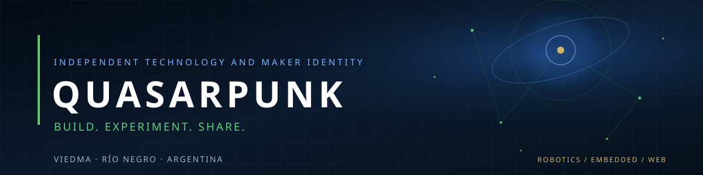

  

# QuasarPunk

**Mauro Emanuel Carrasco** 
Robotics Instructor | Junior IT Support | Embedded Systems | Web Development

> Build. Experiment. Share.

Independent technology and maker identity based in Viedma, Río Negro, Argentina. I work at the intersection of technical education, practical problem-solving, computing and hands-on experimentation.

  
  
  
  
  

## About Me

I am a Robotics Instructor at Punto Digital, Municipalidad de Viedma. I teach programming and electronics with Arduino, design STEM activities for students aged 8 to 15, and troubleshoot hardware and software problems as they appear in class.

Before moving into technology education, I worked for seven years in audiovisual technical production. Operating cameras, configuring equipment for live and recorded television, and solving problems under production deadlines shaped a practical approach: prepare the system, test it in real conditions, and keep the workflow clear for the people around it.

I am now developing my path into IT support, computing, robotics and web development. I learn by building small systems, documenting the process and revising what did not work. **I document what I build, share what I learn.**

### Background

| Role | Organization | Period |
| --- | --- | --- |
| Robotics Instructor | Punto Digital, Municipalidad de Viedma | 2025–Present |
| Audiovisual Production Technician | EnTV, “Cero DB” TV Program | 2017–2024 |
| Private Tutor | Mathematics, English, Biology, Spanish Language and Literature | 2018–2020 |

## Education and Training

| Program | Institution | Detail |
| --- | --- | --- |
| Certified Permaculture Designer | International Permaculture University | 2021 |
| Educational Robotics | Viedma Digital, Municipality of Viedma | 2024 |
| Digital Skills Initiation Program: 360 Vision | IMMUNE Technology Institute | 300-hour training course |
| Solar Panel and Wind Energy Installation | Vocational Training School | 48-hour course, 2022 |
| Cybersecurity and Ethical Hacking | BIG school | 6-hour course, April 2026 |

**Languages:** Spanish — Native · English — Fluent

## Technical Skills

The categories below separate documented use, current learning and stated exploration. They reflect an ongoing transition into IT and should not be read as professional experience in every area.

| Area | Actively used | Currently learning | Exploring |
| --- | --- | --- | --- |
| Robotics & Electronics | Arduino, sensors, actuators, basic automation | Circuit troubleshooting and documentation | Digital fabrication |
| Embedded Systems & Computing | Raspberry Pi 5 and Linux in personal projects | Hardware and software integration | Single-board computing |
| Programming & Web Development | HTML5, CSS3, vanilla JavaScript, responsive static sites, GitHub Pages | Web accessibility and performance practices | Front-end tooling |
| Operating Systems & IT | Linux in personal projects; troubleshooting in teaching and audiovisual work | Technical support and infrastructure fundamentals | System administration |
| Automation | Arduino-based basic automation in teaching | Self-hosted services | IoT |
| Education & Technical Communication | STEM workshops, Arduino instruction, audiovisual production | Technical documentation | Open-source educational resources |

## Featured Projects

### CyberDeck — In Development

**Status:** In Development

A modular portable computing project based on Raspberry Pi 5. It is an ongoing hardware and computing experiment centered on Linux, hardware integration, modular design and portable setups.

No public repository or implementation notes are available at this time, so no completed feature list is claimed here.

### Local Raspberry Pi Cloud — In Development

**Status:** In Development

A local computing and storage project built around Raspberry Pi 5. The goal is to explore self-hosted services and local access to personal digital resources through small-scale home infrastructure.

This is a work in progress. No public documentation is available yet, and no software stack, architecture or completed capability is claimed here.

### Web Development — Functional Projects

Published, working websites built for real organizations and initiatives.

#### Ecoaldea Lamat — Landing Page

**Status:** Published · Functional 
**Technologies:** HTML5, CSS3, vanilla JavaScript, Font Awesome via CDN, GitHub Pages

A single-page institutional site presenting Ecoaldea Lamat and its permaculture foundations. It includes a generated table of contents, section anchors, a back-to-top control and responsive layouts.

[View website](https://quasarpunk.github.io/Ecoaldea-Lamat-Official/) · [Source repository](https://github.com/QuasarPunk/Ecoaldea-Lamat-Official)

#### Ruca Chapad — Multipage Website

**Status:** Published · Functional 
**Technologies:** HTML5, CSS3 with Flexbox and Grid, Bootstrap 5.3 via CDN, vanilla JavaScript, GitHub Pages

A five-page institutional website for a bioconstrucción cooperative: home, team, services, work gallery and contact. It includes responsive layouts, an image viewer and a contact flow that opens WhatsApp or the user's email client.

[View website](https://quasarpunk.github.io/WebSite--RucaChapad/index.html) · [Source repository](https://github.com/QuasarPunk/WebSite--RucaChapad)

## QuasarPunk and Digital Communication

QuasarPunk connects technical work, documentation and communication as parts of the same professional identity. The YouTube channel is a space for technology, educational content and audiovisual communication; Instagram extends that work with a more direct, visual record of the maker practice.

[YouTube](https://youtube.com/@alirafiq98) · [Instagram](https://www.instagram.com/alirafiq98/)

## GitHub Activity

Live public activity metrics for the `QuasarPunk` account, provided by [github-readme-stats](https://github.com/anuraghazra/github-readme-stats).

  

---

**Build. Experiment. Share.**
