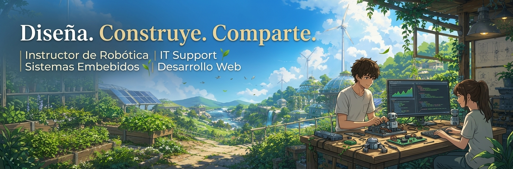
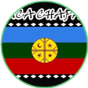

  

# QuasarPunk

**Mauro Emanuel Carrasco** 
Instructor de Robótica | IT Support | Sistemas Embebidos | Desarrollo Web

> Diseña. Construye. Comparte.

Creador y experimentador tecnológico independiente. Interesado en robótica, electrónica, Raspberry Pi, Linux, hardware experimental, automatización, Web Development, fabricación digital, educación tecnológica y cultura Maker / Open Source.

Viedma, Río Negro, Argentina.

## Sobre mí

Soy instructor de Robótica y de Diseño e Impresión 3D en Punto Digital — Municipalidad de Viedma. En robótica enseño programación y electrónica con Arduino, diseño actividades STEM y trabajo con sensores, actuadores y automatización básica. También acompaño a estudiantes de entre 8 y 15 años en la resolución de problemas de hardware y software.

En 2026 incorporé la enseñanza de diseño tridimensional y fabricación digital con Tinkercad, PrusaSlicer e impresión con Ender 3 Pro.

Antes de dedicarme a la educación tecnológica trabajé siete años en producción audiovisual. Operar cámaras, configurar equipos y resolver incidencias durante producciones en vivo y grabadas me dio una forma concreta de trabajar: preparar el sistema, probarlo en condiciones reales y mantener el flujo de trabajo claro para el equipo.

Estoy desarrollando mi carrera hacia IT Support, soporte técnico e infraestructura IT, sin dejar de lado la robótica, los sistemas embebidos y el desarrollo web. Aprendo construyendo, probando y documentando. **Documento lo que construyo y comparto lo que aprendo.**

### Experiencia

| Rol | Institución | Período |
| --- | --- | --- |
| Instructor de Robótica | Punto Digital — Municipalidad de Viedma | 2025–Actualidad |
| Docente de Diseño e Impresión 3D | Punto Digital — Municipalidad de Viedma | 2026–Actualidad |
| Técnico de Producción Audiovisual | EnTV, programa “Cero DB” | 2017–2024 |
| Tutor particular | Matemáticas, Inglés, Biología, Lengua y Literatura | 2018–2020 |

## Formación y certificaciones

| Formación | Institución | Detalle |
| --- | --- | --- |
| Diseñador Certificado en Permacultura | Universidad Internacional de Permacultura | 2021 |
| Robótica Educativa | Punto Digital, Municipalidad de Viedma | 2024 |
| Programa de Iniciación en Competencias Digitales: Visión 360 | IMMUNE Technology Institute | 300 horas |
| Instalación de Paneles Solares y Energía Eólica | Escuela de Formación Laboral | 48 horas, 2022 |
| Ciberseguridad y Hacking Ético | BIG school | 6 horas, abril de 2026 |

**Idiomas:** Español — Nativo · Inglés — Fluent

## Habilidades técnicas

Perfil técnico en formación, con experiencia práctica en docencia, proyectos propios y resolución de problemas.

| Área | Herramientas y conocimientos |
| --- | --- |
| Robótica y electrónica | Arduino, electrónica básica, sensores, actuadores, robótica educativa |
| Computación y sistemas | Raspberry Pi, Linux, hardware |
| Desarrollo web | HTML5, CSS3, JavaScript, Bootstrap 5.3, GitHub Pages |
| Diseño y fabricación digital | Tinkercad, PrusaSlicer, impresión 3D FDM con Ender 3 Pro |
| Educación y resolución de problemas | Enseñanza tecnológica, troubleshooting, comunicación técnica |

## Proyectos y actividades destacadas

### CyberDeck

<table width="100%" cellpadding="8">
<tr>
<td width="88" align="center" valign="middle"></td>
<td valign="top">
<strong>Computadora portátil modular basada en Raspberry Pi 5.</strong> 
Proyecto de experimentación con computación portátil, Linux e integración de hardware. 
<strong>Tecnologías:</strong> Raspberry Pi 5 · Linux · Hardware · Computación modular 
<strong>Estado:</strong> En desarrollo · Sin repositorio público
</td>
</tr>
</table>

### Nube local — Raspberry Pi 5

<table width="100%" cellpadding="8">
<tr>
<td width="88" align="center" valign="middle"></td>
<td valign="top">
<strong>Infraestructura informática local basada en Raspberry Pi 5.</strong> 
Explora servicios propios, almacenamiento y acceso a recursos digitales dentro de una red local. 
<strong>Estado:</strong> En desarrollo · Documentación técnica pendiente
</td>
</tr>
</table>

### Desarrollo web — Sitios publicados

Resultados concretos y funcionales en Web Development.

<table width="100%" cellpadding="8">
<tr>
<td width="88" align="center" valign="middle"></td>
<td valign="top">
<strong>Ecoaldea Lamat — Landing Page</strong> 
Sitio institucional de Ecoaldea Lamat que presenta la comunidad y sus fundamentos de permacultura en una página adaptable. 
<strong>Tecnologías:</strong> HTML5 · CSS3 · JavaScript · GitHub Pages 
<strong>Estado:</strong> Publicado · Funcional 
<a href="https://quasarpunk.github.io/Ecoaldea-Lamat-Official/">Ver sitio</a> · <a href="https://github.com/QuasarPunk/Ecoaldea-Lamat-Official">Repositorio</a>
</td>
</tr>
</table>

<table width="100%" cellpadding="8">
<tr>
<td width="88" align="center" valign="middle"></td>
<td valign="top">
<strong>Ruca Chapad — Sitio multipágina</strong> 
Sitio institucional de una cooperativa de bioconstrucción con cinco páginas, galería de trabajos y formulario de contacto. 
<strong>Tecnologías:</strong> HTML5 · CSS3 · Bootstrap 5.3 · JavaScript · GitHub Pages 
<strong>Estado:</strong> Publicado · Funcional 
<a href="https://quasarpunk.github.io/WebSite--RucaChapad/index.html">Ver sitio</a> · <a href="https://github.com/QuasarPunk/WebSite--RucaChapad">Repositorio</a>
</td>
</tr>
</table>

### Diseño e impresión 3D

<table width="100%" cellpadding="8">
<tr>
<td width="88" align="center" valign="middle"></td>
<td valign="top">
<strong>Actividad docente en Punto Digital · 2026–Actualidad</strong> 
Enseñanza de diseño tridimensional y fabricación digital mediante modelado 3D, preparación de archivos e impresión FDM. 
<strong>Herramientas:</strong> Tinkercad · PrusaSlicer · Ender 3 Pro
</td>
</tr>
</table>

## QuasarPunk y comunicación

QuasarPunk también es una forma de comunicar el proceso: tecnología, educación y comunicación audiovisual forman parte de la misma identidad.

    &nbsp;&nbsp;&nbsp;
    &nbsp;&nbsp;&nbsp;
    &nbsp;&nbsp;&nbsp;
    

## Actividad en GitHub

Métricas públicas de la cuenta `QuasarPunk`, generadas por [github-readme-stats](https://github.com/anuraghazra/github-readme-stats).

  

---

**QUASARPUNK** 
**Diseña. Construye. Comparte.**
